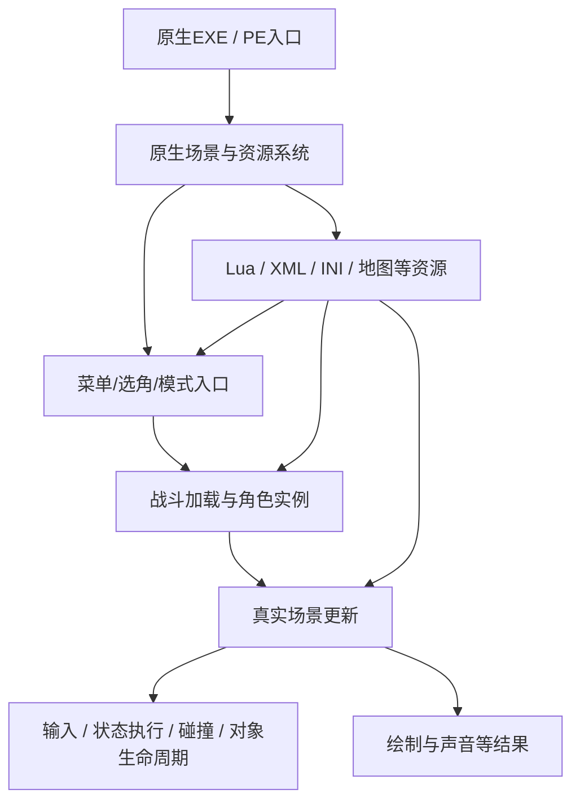

# 01 · 游戏怎样运作：入口不是一个Lua文件

## 工作模型

这是从观察整理的职责关系，不是还原出的完整源码调用图。操作系统使用PE入口；它不等于“开始对战”的入口。本研究重点定位了战斗加载、重置、场景更新、输入和状态排队，尚未完成原程序MainLoop的全图。

## 原生层与脚本层

原生层负责实际对象、角色资源/状态执行、输入处理、碰撞接触、分配销毁等。Lua经引擎绑定取得角色和场景对象，编排教程/剧情初始化、对话、条件、Boss阶段和AI目标。XML可描述教程菜单或行为树，INI可描述动作序列；FOIT等角色资源承载状态相关数据，不能统称“Lua脚本”。

Lua调用一个函数，只证明存在脚本到引擎的接口；要查真实语义，需要找到绑定或实际调用。某些接口把动作排入队列，而不是马上替换当前状态。若每帧重复排入初始化/召唤动作，就可能形成卡顿、重复对象或无法收尾。

## 已定位的生命周期

1. **模式/选角**：UI显示名称、头像、预览，确认后产生待加载角色信息；不保证预览与待加载名是同一变量。
2. **战斗加载**：场景持有待加载双方名，建立角色和资源。隐藏角色替换在这里比改选角格更小、更明确。
3. **外层重置完成**：角色已初始化后，再读取标志/状态表、启用增强或控制器，避免对象半初始化。
4. **真实更新**：读取同一时刻双方局面，传递输入，执行状态及碰撞。调用次数不等于游戏帧，必须排除嵌套和预测。
5. **重赛/换场**：对象和资源代数可能改变；必须作废缓存和未完成任务。
6. **关闭工具**：卸载钩子不自动撤销已经加载的角色或已经进入的状态，可靠回退经常仍需重启游戏。

## 模式入口为什么不同

教程脚本能设置角色，不意味着普通本地对战也走同一个入口。最初通过移动教程验证大熊；后面为了普通训练/本地对战，改为观察原生加载函数。奥莉三阶段也经历“教程沙盒可运行→普通训练接入→本地对战验证”的迁移，场景依赖逐项补齐。

**模式编号是当前场景类型的一条信息，不是完整权限判断。** 本研究的本地CPU可能走0，AI_VANILLA是2，普通训练是10；0也会出现在回放语境。应结合实际入口、角色所有权、阶段、调用点及用户声明。不能见到0就断言“这是人机、不是录像”。

## 哪些脚本真的执行

建立“菜单项/资源键→加载请求→实际脚本→绑定API→对象”的链。文件在磁盘、函数被定义、`require`字符串存在、文件名包含template，都不是完整执行证据。具体核对方法见[02章](02-assets-and-script-routing.md)。

公开实现可从TFHMOD的加载钩子及外层重置钩子读起，见资料源S1。不要直接把全部RVA当作跨版本公共接口。
