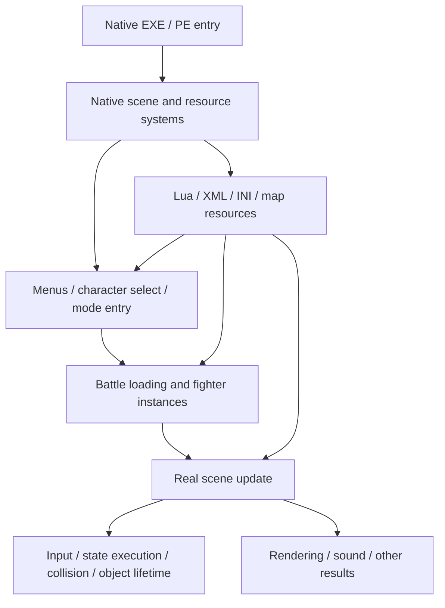

# 01 · How the game runs: the entry point is not a Lua file

[English index](../../README.en.md) · [中文原文](../01-engine-and-lifecycle.md)

## Working model

This is an observation-based responsibility model, not a recovered complete source call graph. The operating system enters through the PE entry point; that is not the “start battle” entry. Our investigation focused on battle loading, reset, scene update, input and state queuing, not a complete reconstruction of the original MainLoop.

## Native and script responsibilities

The native layer handles actual objects, fighter resources and state execution, input, collision/contact, allocation and destruction. Through engine bindings, Lua obtains fighter/scene objects and orchestrates tutorials, story initialization, dialogue, conditions, boss phases and AI goals. XML can describe tutorial menus or behavior trees; INI can describe action sequences. Fighter resources such as FOIT contain state-related data: they are not all “Lua scripts.”

A Lua function call establishes a script-to-engine interface, not its complete semantics. Find the binding or actual call path. Some interfaces queue an action rather than immediately replacing the current state. Queuing initialization or summoning every frame can cause stalls, duplicate objects or broken cleanup.

## Located lifecycle stages

1. **Mode/character selection:** UI displays names, portraits and previews; confirmation produces pending fighter information. The preview and pending load name need not share one variable.
2. **Battle loading:** the scene holds pending names and constructs fighters/resources. Replacing a hidden fighter here is more narrowly defined than editing selection slots.
3. **After the outer reset completes:** read flags/state tables and enable enhancements/controllers only after initialization, avoiding half-initialized objects.
4. **Real update:** observe both sides at the same instant, pass input, execute states and contacts. Call count is not frame count; exclude nested and prediction work.
5. **Rematch/scene transition:** object and resource generations may change. Invalidate caches and unfinished requests.
6. **Tool shutdown:** detaching hooks does not automatically undo a loaded fighter or entered state. Reliable rollback may still require restarting the game.

## Why mode entry paths differ

A tutorial script's ability to select a fighter does not imply that ordinary local versus uses that entry point. Huggles was first validated in the movement tutorial; ordinary training/local matches required observing native loading. Phase-3 Oleander likewise progressed from tutorial sandbox to ordinary training to local-match testing, addressing scene dependencies individually.

**A mode number is one piece of scene information, not a complete authorization check.** Observed local CPU matches can use 0, AI_VANILLA is 2, and ordinary training is 10; 0 also occurs in replay contexts. Combine actual entry path, fighter ownership, phase, call site and the user's declared activity. Do not conclude “CPU match, not replay” from 0 alone.

## Which scripts actually run?

Build the chain “menu item/resource key → load request → actual script → bound API → object.” A disk file, function definition, `require` string or filename containing `template` is not complete execution evidence. See [chapter 02](02-assets-and-script-routing.md).

The public TFHMOD load and outer-reset hooks are useful starting points; see source S1. Do not treat their RVAs as cross-version public interfaces.
